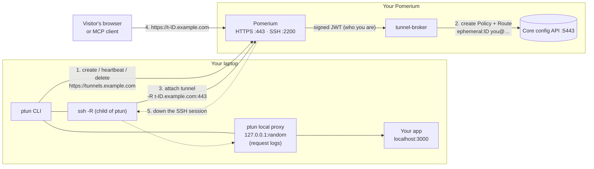
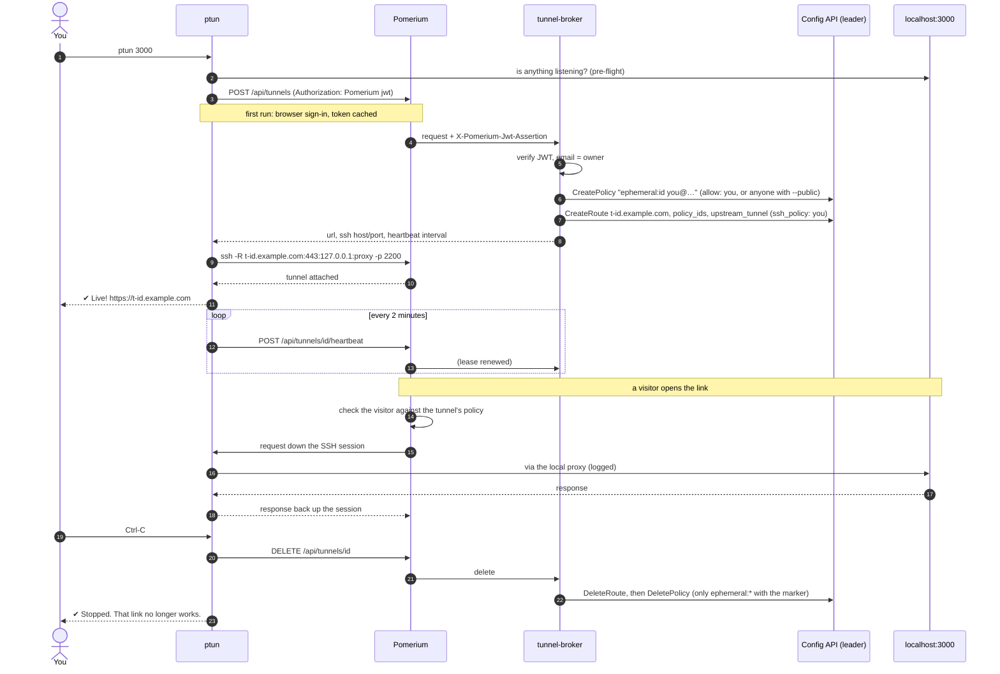

# ptun

An independent experiment, not an official Pomerium project.

`cloudflared tunnel --url http://localhost:8081`, on Pomerium. One command exposes a local port at a fresh URL;
the route disappears when the command stops.

```bash
go install github.com/nickytonline/ptun/cmd/ptun@latest
ptun init ssh.example.com:2200      # once; derives the broker (tunnels.example.com)
ptun 8081                           # == ptun http://localhost:8081
ptun --public 3000                  # anyone with the link can open it, no sign-in
ptun --mcp 3000                     # share an MCP server (prints the MCP URL for your client)
ptun --stable 3000                  # same link every run: https://k3x9.example.com
ptun --name demo 3000               # same link every run, named: https://demo-k3x9.example.com
ptun start 3000                     # same as ptun 3000
# -> https://t-k3x9qa.example.com   (Ctrl-C removes it)
```

## Install

```bash
go install github.com/nickytonline/ptun/cmd/ptun@latest   # installs to $(go env GOBIN) or ~/go/bin
```

Needs Go 1.27+ and `ssh` on your `PATH`. While the repo is private, Go has to fetch it with your Git credentials
instead of the public module proxy: `go env -w GOPRIVATE=github.com/nickytonline/ptun` once (and Git access to the repo).

`ptun` needs a tunnel broker behind your Pomerium. To run one, see [docs/install.md](docs/install.md).

Config lives in `os.UserConfigDir()/ptun` (`~/Library/Application Support/ptun` on macOS, `~/.config/ptun` on Linux):
`config.json` (broker host) and `token.json` (cached Pomerium session JWT, mode 0600).

## Commands

### `ptun <port|url>`: share an app

Shares a local app at a fresh `https://t-<id>.<domain>` URL until you press Ctrl-C. `<port>` means
`http://localhost:<port>`; a URL must point at `localhost`, `127.0.0.1` or `::1`. With no argument, `ptun` prints its help.

```bash
ptun 3000                          # only you can open it, after signing in
ptun http://localhost:8081         # same, with an explicit URL
ptun --public 3000                 # anyone with the link, no sign-in (if the broker allows public links)
ptun --mcp 3000                    # share an MCP server; prints and copies the MCP URL (<url>/mcp)
ptun --mcp --mcp-path /sse 3000    # MCP server whose endpoint is /sse
ptun --stable 3000                 # the same link every run (<your id>.<domain>)
ptun --name demo 3000              # the same link every run, with a name (demo-<your id>.<domain>)
ptun --quiet 3000                  # no per-request log lines
ptun --show-visitor 3000           # add who opened each request (signed-in visitors only)
ptun --no-check 3000               # skip the "is your app running?" check
```

| Flag | Default | What it does |
|---|---|---|
| `--public` | off | Visitors: you OR anyone (no sign-in). Refused unless the broker sets `ALLOW_PUBLIC_TUNNELS=true`. Attaching the tunnel stays creator-only. |
| `--mcp` | off | The route fronts an MCP server (Pomerium handles the MCP sign-in). No upstream OAuth yet (#1). |
| `--mcp-path <path>` | `/mcp` | Path of the MCP endpoint on your app. Used in the printed URL and the route's MCP config. |
| `--stable` | off | Use your stable link `https://<id>.<domain>` instead of a random one. See [Stable links](#stable-links). |
| `--name <name>` | none | Stable link with a name: `https://<name>-<id>.<domain>`. 1-32 letters, digits or hyphens. Implies `--stable`. |
| `--quiet` | off | Don't print a line per request. The link and status lines still print. |
| `--show-visitor` | off | Append the visitor's email (from Pomerium's identity header, display only) to each log line. |
| `--no-check` | off | Don't check that something is listening on the port before creating the link. |

Flags can go before or after the port.

### `ptun start <port|url>`

The same as `ptun <port|url>`, with the same flags (`ptun start --public 3000`).

### `ptun init <pomerium-ssh-host>`: one-time setup

```bash
ptun init ssh.example.com:2200                                  # saves broker tunnels.example.com
ptun init ssh.example.com:2200 --broker broker.example.net      # broker somewhere else
```

Give it the Pomerium SSH endpoint you'd use for `ssh -R`. `ptun` derives the broker host from it (`ssh.X` becomes
`tunnels.X`); a host that doesn't start with `ssh.` is saved as the broker host itself. `--broker <host>` overrides it.
The broker tells `ptun` which SSH host and port to use, so you never type the SSH endpoint again.

### Other commands

- `ptun help [command]`, `ptun --help`, `ptun <command> --help`
- `ptun completion bash|zsh|fish|powershell` prints a shell completion script.

### Environment variables

| Variable | What it does |
|---|---|
| `PTUN_NO_BROWSER=1` | Print the sign-in URL instead of opening a browser. |
| `PTUN_BROKER_URL=http://127.0.0.1:8080` | Dev mode only: talk plain HTTP to a local broker and skip sign-in. Only `http://127.0.0.1:<port>` or `http://localhost:<port>` are accepted. See [Dev mode](#dev-mode-your-laptop). |

## How it works

### The pieces



- **ptun** (on your laptop) asks the broker for a link, runs `ssh -R`, and logs each request through a small local proxy.
- **tunnel-broker** (in the cluster) is the only piece allowed to create routes. It sits behind its own Pomerium route,
  so Pomerium tells it who is calling, and it creates or deletes a Policy plus a Route per tunnel through the config API.
- **Pomerium** does the rest: it checks the visitor against the tunnel's policy and sends allowed requests down your SSH session.

### What happens on `ptun 3000`



If `ptun` dies without the Ctrl-C step (crash, laptop asleep), heartbeats stop and the broker deletes the route and policy
after the 10 minute TTL.

### Details

1. `ptun` signs in through Pomerium's programmatic login: `GET https://<broker>/.pomerium/api/v1/login?pomerium_redirect_uri=http://127.0.0.1:<port>/`
   returns a sign-in URL; after sign-in Pomerium redirects the browser to the loopback listener with `?pomerium_jwt=`.
   The JWT is cached and sent as `Authorization: Pomerium <jwt>`. On 401/403/redirect it signs in once more.
2. `POST /api/tunnels {"target":"localhost:8081"}` (plus `"stable": true` and/or `"name": "demo"`) returns
   `{id,url,hostname,ssh_host,ssh_port,stable,expires_at,heartbeat_interval_seconds}`.
3. `ptun` starts a local logging reverse proxy on `127.0.0.1:<random port>` (WebSockets work) and runs
   `ssh -p 2200 -N -R <hostname>:443:127.0.0.1:<proxy port> <ssh_host>` as a child (only the sign-in link and errors from ssh
   are shown), heartbeats every `heartbeat_interval_seconds`, and on exit or SIGINT/SIGTERM
   forwards the signal to ssh, calls `DELETE /api/tunnels/<id>` and exits with ssh's code.

### Broker

Headless HTTP API (`cmd/tunnel-broker`): `POST /api/tunnels`, `POST /api/tunnels/{id}/heartbeat`,
`DELETE /api/tunnels/{id}`, unauthenticated `GET /healthz`.

- Auth: `X-Pomerium-Jwt-Assertion` verified against the JWKS (`JWKS_URL`, default
  `https://<BROKER_HOST>/.well-known/pomerium/jwks.json`) with `aud` = `JWT_AUDIENCE` (the broker host). The
  `email` claim is the owner and `sub` is the source of the stable id. Only heartbeat/delete by the creating email.
- Policy and route: Core ignores `Route.ppl_policies` for routes stored through the config API and only enforces
  `policy_ids`. So each tunnel gets a Policy `ephemeral:<id> <email>` (`source_ppl`: `allow: and: - email: is: <email>`),
  created first, and a Route `ephemeral:<id> <email>` with `policy_ids=[policy]`, `from https://t-<id>.<BASE_DOMAIN>`
  (or the [stable hostname](#stable-links), checked against every existing route first),
  `allow_websockets`, and the same PPL inline in `upstream_tunnel.ssh_policy` (which Core does honour). If the route
  cannot be created the policy is deleted.
- Config API: Connect `ConfigService` via `sdk-go` with `SHARED_SECRET` (base64) as the API token, like the Pomerium
  Terraform provider. `CONFIG_API_URLS` lists the endpoints (with a clustered databroker only the Raft leader answers), and
  each call tries them in order starting with the last that worked. TLS verification is skipped for now (the cert is derived from the shared secret);
  `CONFIG_API_TLS_VERIFY=true` is reserved for the follow-up (TODO in `internal/broker/client.go`).
- Settings are environment variables; see [docs/install.md](docs/install.md#2-settings).

## What you see

```
✔ Signed in as you@example.com
✔ Created your link
⏳ Connecting… (if a sign-in link appears below, open it)
✔ Live! Your app on localhost:3000 is at:
    https://t-k3x9qa.example.com      (copied to clipboard)
  Who can open it: only you, after signing in
  Press Ctrl-C to stop sharing.
13:04:05  GET     /api/items  200  12ms
```

- Pre-flight: if nothing accepts TCP on the target, ptun stops before creating anything ("Nothing is running on
  localhost:3000 yet..."). `--no-check` skips it.
- Request log: one line per request (`HH:MM:SS  METHOD  path  status  duration`, `101 (websocket)` for upgrades).
  `--quiet` turns it off. `--show-visitor` appends the visitor email decoded (not verified, display only) from
  `X-Pomerium-Jwt-Assertion`; the broker sets `pass_identity_headers` on the routes it creates. If the app is down,
  visitors get a small friendly 502 page and the log says `→ nothing running on localhost:3000`.
- "Live!": printed on the proxy's first request or when a self-probe (`X-Ptun-Probe`, answered 204 by the proxy, never
  forwarded or logged) gets through. That only works for public links. Private links (and MCP links, which answer
  401) cannot be probed from outside, so they count as live once ssh has run about 5 seconds without error.
- Errors are plain sentences: not set up, public/MCP not allowed (403 from the broker), service unreachable, SSH
  sign-in rejected ("Permission denied").
- ssh stderr is filtered: only lines with a URL (the sign-in link) or an error-looking word are shown, partial lines
  (prompts) are forwarded immediately, stdin is passed through.

## Stable links

`ptun 3000` gets a new random URL (`t-<6 random chars>`) every run. `--stable` and `--name` give the same URL every run,
so you can bookmark it, paste it into a webhook or OAuth config once, and keep it.

```
ptun --stable 3000       ->  https://k3x9.example.com
ptun --name demo 3000    ->  https://demo-k3x9.example.com
ptun --name api 8080     ->  https://api-k3x9.example.com
```

- **`k3x9` is your id**, the same for every name. The broker computes it as 4 base36 characters of
  `sha256(BASE_DOMAIN + "|" + sub)`, where `sub` is the IdP subject in the Pomerium JWT the broker already verifies.
  Nothing is stored. The id is one-way: the URL reveals neither your `sub` nor your email, and 4 characters can't be
  reversed (huge numbers of subjects share each id). Someone who already has your exact `sub` could compute it and
  confirm the URL is yours. It changes only if your IdP subject changes (an email change does not change it). Two
  accounts (two `sub`s) get two ids.
- **Only the hostname is stable.** The route and policy are still created on start and removed on Ctrl-C, so the URL
  returns Pomerium's 404 while ptun isn't running.
- **One live tunnel per link.** Different names run side by side (up to `MAX_TUNNELS_PER_USER`). Running the same
  `--name` (or `--stable`) while it's live is refused (409) with a hint, like ngrok's "endpoint already online"; there
  is no take-over flag. So that a crashed ptun doesn't hold its link for long, stable links heartbeat every 30s with a
  2 minute lease (random links keep 2m/10m). Another user can never
  take your link: different `sub`, different id. If a stable hostname is used by any route that isn't your own tunnel
  (a hand-made route, someone else's tunnel), the broker refuses with 409 and touches nothing.
- **`--public --stable`** makes a public URL that never changes, so anyone who has seen it can come back. ptun prints a
  reminder. Dev brokers (`DEV_AUTH_EMAIL`) use a subject derived from the email, so their stable ids differ from the
  deployed broker's.

## MCP tunnels

`ptun --mcp 3000` (optionally `--mcp-path /sse`, default `/mcp`) sends `{"mcp": true, "mcp_path": ...}`. The broker sets
`Route.mcp = {server: {path: <mcp_path>}}` (`MCPServer.path` is the path Pomerium appends when it lists the server URL, so
it is the endpoint clients should use) with no `upstream_oauth2`. The CLI prints `MCP server URL: <url><path>`, copies
that instead of the bare URL, and hints to add it to your MCP client as a remote MCP server (it signs you in through
Pomerium). Needs the `mcp` runtime flag in Pomerium. Gate:
`ALLOW_MCP_TUNNELS` (default true). Public and MCP can be combined if public is allowed.

## Public tunnels

`ptun --public 3000` sends `{"target":..., "public": true}`. The broker only honours it when `ALLOW_PUBLIC_TUNNELS=true`;
otherwise it answers 403 "public tunnels are disabled on this broker", which the CLI prints as is. A public tunnel's visitor policy has this shape: `[{allow: {or: [{email: {is: <creator>}}, {accept: true}]}}, {allow: {and: [{cors_preflight: true}]}}]`
(emitted as JSON). Who may attach the tunnel (`upstream_tunnel.ssh_policy`) stays creator-only in both cases. Names stay
`ephemeral:<id> <email>`; the description says "public tunnel" or "private tunnel". The CLI prints
`PUBLIC: anyone with this link can open it, no sign-in.` under the URL box, and the broker logs `public` on creation.
Response JSON gains `"public"`, `"mcp"`, `"mcp_path"` and `"email"` (the authenticated caller, shown as "Signed in as"). A broker restart re-derives it from the route description.

## Security notes

- The broker holds `shared_secret`, which is full admin over Pomerium Core. It trusts `X-Pomerium-Jwt-Assertion`, so
  only Pomerium may be able to reach it (in Kubernetes, a NetworkPolicy that admits only the Pomerium pods). Who may
  create tunnels is the policy on the broker's own Pomerium route.
- Invariant: the broker only ever creates, adopts or deletes objects it owns. Ownership needs BOTH the name prefix
  (`ROUTE_PREFIX`, default `ephemeral:`; must end with `:`) AND the description marker `managed by tunnel-broker`. It is
  enforced in one place (`Routes.guard` in `internal/broker/routes.go`): `Create` checks the route it is about to make,
  and route delete, policy delete, adopt (`ListManaged`) and the orphan-policy sweep all re-read the object and check
  prefix and marker. A hand-made route or policy named `ephemeral: something` has no marker, so it is never adopted or
  deleted.
- The broker needs to reach the config API (Core's `grpc_address`, 5443) on every member.

## Cleanup model

In-memory leases (id -> route id, owner, expiry), renewed by heartbeats. A sweeper runs every minute and deletes expired
routes (crash, laptop sleep). On start the broker lists `ephemeral:*` routes and adopts them with a fresh TTL, so a broker
restart keeps live tunnels (the policy id comes from the route's `policy_ids`) and orphans are still swept. Adopt also
deletes `ephemeral:*` policies that no `ephemeral:*` route references and no lease owns. Terraform ignores these routes because they are not in its state.

## Troubleshooting

| What you see | Likely cause | What to check |
|---|---|---|
| `isn't responding (503 Service Unavailable)` (also 502/504) | The broker route exists, but the broker behind it isn't running, isn't ready, or is failing. Sign-in already worked. | The broker's status and logs (`kubectl -n <ns> logs deploy/tunnel-broker`). Common: the image can't be pulled, a crash at startup (a required setting missing, bad `ROUTE_PREFIX`), or the NetworkPolicy not admitting Pomerium. |
| `no tunnel broker at https://... (404)` | No Pomerium route for the broker host. | `ptun init` used the wrong host, or the broker's Pomerium route doesn't exist. |
| `Can't reach your organization's ptun service` | DNS or network: the broker host doesn't answer at all. | Your connection, and that `tunnels.<domain>` resolves. |
| Broker logs `config API` errors | It can't reach the Raft leader on 5443. | `CONFIG_API_URLS` is right and nothing (a NetworkPolicy, a firewall) blocks the broker from 5443 on every member; the members are up. |
| Broker logs JWT/JWKS errors, `ptun` gets 401/403 after signing in | It can't fetch or match Pomerium's signing keys. | Set `JWKS_URL` to a URL reachable from the pod; check `JWT_AUDIENCE` matches the broker host. |
| `Connection to ssh... closed by remote host` ~30s after start | The SSH sign-in account differs from the tunnel's owner, or an SSH sign-in prompt was hidden (#2). | Sign in to SSH as the account `ptun` shows in "Signed in as". |

## Development

### Build and test

```bash
go vet ./... && go test -race ./...
go build -o bin/ptun ./cmd/ptun && go build -o bin/tunnel-broker ./cmd/tunnel-broker   # bin/ is gitignored
go install ./cmd/ptun   # use your local build as `ptun`: installs to $(go env GOBIN) or ~/go/bin, no sudo
```

## Running the broker

Users only ever run `ptun`; the broker is the service behind it. To run one next to your Pomerium (prerequisites,
settings, Docker and Kubernetes), see [docs/install.md](docs/install.md).

Restarting the broker doesn't break live tunnels: on startup it adopts existing `ephemeral:*` routes with a fresh lease,
and clients keep sending heartbeats.

### Dev mode (your laptop)

Run `tunnel-broker` locally against a real Pomerium Core to test broker or CLI changes. Both modes create real
`ephemeral:*` routes and policies.

```bash
# Terminal 1: the broker. Use the email you sign in to Pomerium with (it must match your SSH sign-in too).
go build -o bin/tunnel-broker ./cmd/tunnel-broker
SHARED_SECRET=... CONFIG_API_URLS=https://127.0.0.1:5443 \
  BROKER_HOST=tunnels.example.com BASE_DOMAIN=example.com SSH_HOST=ssh.example.com \
  DEV_AUTH_EMAIL=you@example.com LISTEN_ADDR=127.0.0.1:8080 ALLOW_PUBLIC_TUNNELS=true \
  bin/tunnel-broker

# Terminal 2: point ptun at it (all the usual flags work)
PTUN_BROKER_URL=http://127.0.0.1:8080 ptun 3000
```

- `CONFIG_API_URLS` must reach Core's config API, for example through a port-forward.
- `DEV_AUTH_EMAIL` turns JWT verification off (no Pomerium in front, so no JWT; every request is that email). The
  broker refuses it unless `LISTEN_ADDR` is loopback.
- `PTUN_BROKER_URL` makes `ptun` talk plain HTTP to `127.0.0.1`/`localhost` only and skip sign-in.
- Don't put the shared secret in your shell history; load it from a secret manager into the broker's environment.

Ctrl-C on `ptun` deletes its own route and policy. If you stop the broker first, the deployed broker (or the next local
run) adopts the leftovers and deletes them after the 10 minute TTL.

**Don't run a dev broker while a deployed broker is running.** At startup each broker adopts every existing
`ephemeral:*` route, but `ptun` only sends heartbeats to the broker that created its tunnel. So a dev broker deletes the
deployed broker's live tunnels 10 minutes after it starts, and the other way round (#2). Scale the deployed broker to
0 while testing, or test against a different `ROUTE_PREFIX` (for example `ROUTE_PREFIX=dev-ephemeral:`).

## License

[Apache License 2.0](LICENSE).
